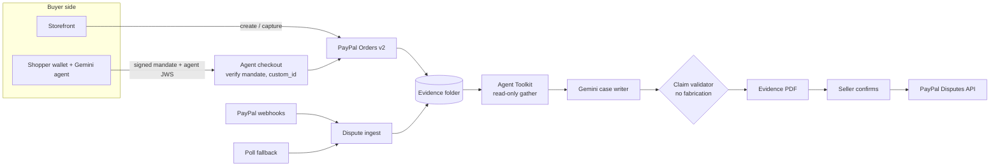

# Seller Shield

**An AI copilot that keeps small PayPal sellers' money safe from disputes, including "my AI bought it, not me".**

Live demo: <RENDER_URL>
Video: <YOUTUBE_URL>

Built for the [PayPal AI Hackathon](https://paypalaihackathon.devpost.com/). PayPal sandbox only, fake money. MIT licensed.

## Problem

Small sellers lose disputes they should win, and the paid fix takes a cut of the recovery. Evidence from Reddit (threads from our research notes):

- "Lost a $2,400 chargeback after providing signed delivery receipts": 332 upvotes, r/smallbusiness, [thread 1xcbqm0](https://www.reddit.com/comments/1xcbqm0).
- PayPal refunded the buyer $1,700, let him keep the goods and charged the seller a dispute fee: 157 upvotes, r/paypal, [thread 1xlqgzp](https://www.reddit.com/comments/1xlqgzp).
- "spent 4 hours writing a response... Lost anyway", because the evidence did not match the reason code: r/smallbusiness, [thread 1rvbwtz](https://www.reddit.com/comments/1rvbwtz). Recovery tools such as Chargeflow take about 25% of what they win back.

Shoppers now also buy through AI agents. When one denies the purchase, the seller has no proof that a human authorised it.

## What it does

| Stage | What happens |
|---|---|
| **Prevent** | Each order is checked against PayPal's US Seller Protection policy (last updated 2026-01-26): ship-to address matches the PayPal transaction, verifiable tracking exists and is on PayPal, "delivered" status for Item Not Received, the $10,000 cap, intangible-goods rules. A gap gets a one-sentence explanation and a one-click fix (for example, push tracking to PayPal). |
| **Prove** | Every order builds an evidence folder (PayPal order and capture, shipment, messages, protection check, mandate). |
| **Defend** | A dispute arrives by webhook or poll. Seller Shield explains the claim, recommends fight, offer or accept with the expected dollars kept, drafts a case where every timeline and argument entry cites evidence (the summary is built in code, not by the AI), renders a PDF evidence pack, and submits only after the seller confirms. |

**Agent mandate flow.** The shopper signs a purchase mandate (what the agent may buy, max amount, expiry). The Gemini shopping agent signs its own request. At checkout the shop verifies both Ed25519 signatures, rejects anything outside the mandate, claims the mandate once (single use), and writes the mandate hash into the PayPal order's `custom_id`; at capture the app reads `custom_id` back from PayPal and records whether it matches. The human still approves in PayPal. If the purchase is later disputed, the signed mandate is evidence of authorisation.

## Judge walkthrough

Open `/demo` on the hosted app. It lists these six steps, shows the **sandbox test buyer credentials** (fake money), AI calls left today, and has a Reset button.

1. **Buy as a human.** Storefront `/`, add a product, pay with PayPal, log in with the sandbox buyer shown on `/demo`.
2. **Let the AI agent buy.** Sign a purchase mandate in `/wallet`, then ask the agent to buy in `/agent`.
3. **See Prevent.** `/dashboard` lists orders with protection status; open an at-risk order and use the one-click fix. `/demo` also has a button to mark a shipped order delivered (simulated carrier).
4. **Open a dispute.** Fastest: the simulated dispute form on `/demo`. Or open a real sandbox dispute as the test buyer on sandbox.paypal.com (Activity, Report a problem), then use the poll button on `/demo`.
5. **Defend it.** `/dashboard/disputes`, open the case: recommendation, cited case, PDF evidence pack. Confirm to submit. Nothing is sent before that click.
6. **Resolve.** Resolve from `/demo`. Simulated disputes resolve locally; real sandbox disputes settle once they are under review.

## Architecture



Stack: Next.js 15 (App Router), TypeScript, Tailwind, AG Grid (orders and disputes), Postgres via Drizzle (Neon in production, PGlite locally), pdf-lib, jose.

## PayPal APIs used

| API | Endpoint family | Code |
|---|---|---|
| OAuth | `POST /v1/oauth2/token` | `src/lib/paypal/client.ts` |
| Orders v2 | `POST /v2/checkout/orders` (with `custom_id`), `POST .../{id}/capture`, `GET .../{id}` | `src/lib/paypal/orders.ts` |
| Orders v2 tracking | `POST /v2/checkout/orders/{id}/track` | `src/lib/paypal/tracking.ts` |
| Disputes v1 | `GET /v1/customer/disputes`, `GET .../{id}`, `provide-evidence`, `make-offer`, `accept-claim`, `send-message`; sandbox-only `require-evidence`, `adjudicate` | `src/lib/paypal/disputes.ts` |
| Webhooks | `POST /v1/notifications/verify-webhook-signature`; receiver at `/api/webhooks/paypal`; registration helper | `src/lib/paypal/webhooks.ts`, `src/app/api/webhooks/paypal/route.ts`, `scripts/register-webhook.ts` |
| JavaScript SDK | `paypal.com/sdk/js` Buttons for human checkout | `src/components/PayPalButton.tsx` |
| Agent Toolkit | `@paypal/agent-toolkit`, read-only tools `get_dispute`, `get_order`, `get_shipment_tracking` | `src/lib/defense/toolkit-gather.ts` |

Webhook events are ingested idempotently, with a throttled poll as backup (`/api/cron/poll-disputes`, `src/lib/disputes/ingest.ts`).

## AI usage

Google Gemini through the Vercel AI SDK (`ai` v7, `@ai-sdk/google`). Two tiers, resolved from the model list unless pinned (`src/lib/ai/gemini.ts`): **quality** (newest stable "pro", or `GEMINI_MODEL`) writes the dispute case with a low thinking setting; **fast** (newest stable "flash", or `GEMINI_MODEL_FAST`) runs the gap explanations, the Agent Toolkit investigator and the shopper agent. SDK retries are off (`maxRetries: 0`) so the daily cap counts real calls.

- **Structured output** (`generateObject`, zod schemas): the dispute case writer and plain-language protection-gap explanations.
- **Tool calling** (`generateText` with tools): the shopper agent (`src/lib/agent/shopper-agent.ts`) and the Agent Toolkit investigator (`src/lib/defense/toolkit-gather.ts`).
- **No-fabrication validator** (`validateClaims` in `src/lib/defense/case.ts`): every timeline and argument entry must cite evidence records, and any date, amount or tracking number not found in the cited records rejects the draft. The case summary and the notes sent to PayPal are built in code from those validated entries, never from AI free text. A rejected draft falls back to `templateCase`, built only from folder items.
- **Daily AI cap** (`AI_DAILY_CALL_LIMIT`, default 300, database-backed counter; `src/lib/ai/gemini.ts`, `src/lib/ai/budget.ts`) with deterministic fallbacks, so the demo still works with AI off, capped or rate-limited.
- **PayPal Agent Toolkit**: `@paypal/agent-toolkit` 1.11 targets AI SDK v4, so only its three read-only tools are used, each re-wrapped as an AI SDK v7 `tool()` that delegates to the toolkit's own `execute`.

## Honesty: what is simulated and why

- **Sandbox only.** All money is fake; no live PayPal credentials are used.
- **Carrier deliveries are simulated.** The sandbox has no carriers, so "mark delivered" on `/demo` records a demo delivery, tagged **Simulated** in the UI.
- **Simulated disputes** are created by the demo, not PayPal, and tagged **Simulated** (their evidence PDF carries a "SIMULATED DISPUTE" cover banner). Resolving one does not call PayPal. Real sandbox disputes go through the real Disputes API.
- **Hard rules:** nothing is submitted to PayPal without the seller's confirmation, and every case sentence cites evidence, enforced by the validator in code.
- Seller Shield does not decide disputes; PayPal does.

## Local setup

Prerequisites: Node 22+.

```bash
npm ci
cp .env.example .env     # then fill in the keys below
npm run db:migrate
npm run seed             # demo state; needs working sandbox credentials
npm run dev              # http://localhost:3000
```

| Variable | Where to get it |
|---|---|
| `PAYPAL_CLIENT_ID`, `PAYPAL_CLIENT_SECRET` | [PayPal developer dashboard](https://developer.paypal.com/dashboard/applications/sandbox), sandbox REST app |
| `PAYPAL_WEBHOOK_ID` | `npx tsx scripts/register-webhook.ts https://<your-host>/api/webhooks/paypal` prints it |
| `SANDBOX_BUYER_EMAIL`, `SANDBOX_BUYER_PASSWORD` | Dashboard, Testing Tools, Sandbox Accounts (personal account); shown on `/demo` |
| `GEMINI_API_KEY` | [Google AI Studio](https://aistudio.google.com/apikey) |
| `GEMINI_MODEL`, `GEMINI_MODEL_FAST`, `AI_DAILY_CALL_LIMIT` | Optional |
| `DATABASE_URL` | [Neon](https://neon.tech) Postgres connection string |
| `APP_BASE_URL` | Public URL, used for webhooks and return URLs |
| `SHOPPER_AGENT_PRIVATE_JWK` | `npx tsx scripts/gen-agent-key.ts`; set it on hosted deployments |

**Zero-config local mode.** With `DATABASE_URL` empty and `NODE_ENV` not production, the app uses a file-backed PGlite database (`.data/pglite`). `npm run dev:fixtures` (stop `next dev` first) inserts clearly fake sample orders and simulated disputes, so the dashboard has data without PayPal.

Tests, lint, build:

```bash
npm test         # vitest, offline, in-memory Postgres: 379 tests in 42 files
npm run lint
npm run build
```

## Deploy

Hosted on Render with Neon Postgres. Set the variables above, run `npm run db:migrate` and `npm run seed`, register the webhook with `scripts/register-webhook.ts`, and set `SHOPPER_AGENT_PRIVATE_JWK` so agent keys survive restarts. A `render.yaml` blueprint is not in the repo yet.

## Built during the hackathon

Built within the hackathon period (Oct 1 - Nov 12, 2026); this repository was started on 2026-11-03. Team: Aarjav Jain (solo).

## License

[MIT](LICENSE), Copyright (c) 2026 Aarjav Jain.
